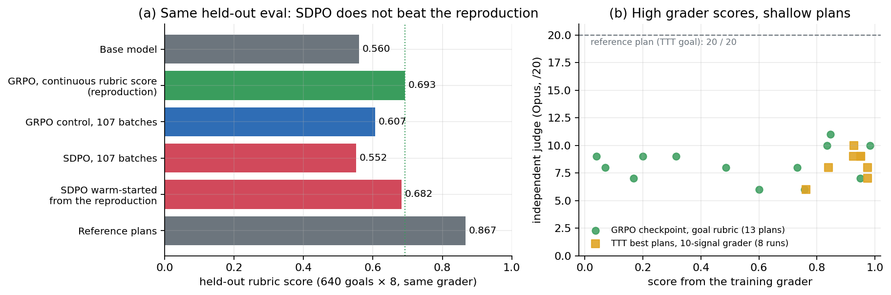

<div align="center">

# Training LLMs for Scientific Research Planning

[-b31b1b.svg)](https://arxiv.org/abs/2512.23707)
[](https://huggingface.co/datasets/facebook/research-plan-gen)
[](LICENSE)

**Yuhong Shi** · Torr Vision Group, University of Oxford · Dec 2025 – Apr 2026

</div>

RL post-training of Qwen3-30B-A3B to write research plans, scored by rubrics.
- GRPO: a reproduction of the paper's recipe.
- Three extensions: evolving rubrics, self-distillation, and test-time training.

Each method has its own folder with code, experiment data and an analysis.

<p align="center"></p>

- **Motivation.** Research plans have no verifiable reward, so we use rubrics to make this open-ended task trainable, following the [ResearchPlanGen](https://arxiv.org/abs/2512.23707) dataset.
- **Method.**
  - I reproduced their results without released code by refining the rubric reward into a continuous score.
  - Besides GRPO, I also implemented:
    - evolving rubrics ([DR Tulu](https://arxiv.org/abs/2511.19399))
    - self-distillation from grader feedback ([SDPO](https://arxiv.org/abs/2601.20802))
    - test-time training that reuses past attempts ([TTT-Discover](https://arxiv.org/abs/2601.16175))
- **Finding.**
  - None of these methods brought a clear improvement over the reproduction.
  - In our experiments, the rubric reward was easily hacked and too coarse to convey deep scientific content.
  - So the policy mainly learned format and pattern preferences.

## Results
| Folder | Method (follows) | Against the GRPO reproduction | Evidence that the reward is hacked or too coarse |
|---|---|---|---|
| [`grpo/`](grpo/) | GRPO with a continuous rubric score ([Goel et al.](https://arxiv.org/abs/2512.23707)) | **The reproduction.** Held-out score 0.560 → **0.693** (+23.7%). The paper reports 12–22% under a different evaluator | Format-valid samples 76% → 100%, and length moved to the length-bonus centre. Opus judges 13 trained-checkpoint plans at 6–11 / 20; the top-rubric plan (0.949) gets 7 |
| [`evolving_rubric/`](evolving_rubric/) | Rubrics regenerated from current rollouts ([DR Tulu](https://arxiv.org/abs/2511.19399)) | Not shown: mechanism runs only (≤ 10 iterations). The pass-rate rise 0.20 → 0.60 is composition (0.31 → 0.34 on a fixed item set) | 6 of 9 evolved items name gaming behaviours the fixed reward misses, e.g. "gratuitous formalism", "invented metric without derivation" |
| [`sdpo/`](sdpo/) | Self-distillation from grader feedback ([SDPO](https://arxiv.org/abs/2601.20802)) | Worse: 0.552, against 0.607 for a same-script GRPO control. Warm-started from the reproduction: 0.682 < 0.693 | Ahead of the control for 80 of 107 batches (peak 0.607 vs 0.591), then collapses |
| [`ttt/`](ttt/) | Test-time training that reuses past attempts ([TTT-Discover](https://arxiv.org/abs/2601.16175)) | RL = no RL at best-of-2 (0.950 both). The best-of-1 gap (0.928 vs 0.840) is one run, and the mean sample does not move | The training grader gives 0.95–0.975 while Opus gives 6–10 / 20, against 20 for the reference plan |

- Every number in the READMEs is recomputed from the folder's `data/` by `analysis/check_numbers.py`.
- Runs are single seeds.
- Opus scores are single judgments.

## Repository structure
```
grpo/  sdpo/  ttt/  evolving_rubric/   one folder per method
├── README.md                          method → code (with line links) → run → results → takeaways → data → limitations
├── *.py                               implementation (python -m <method>.<module>)
├── configs/ or data/runs/*/config.json   configs of the reported runs
├── data/                              experiment data (numeric only)
├── analysis/                          make_figures.py, check_numbers.py, figures/
└── tests/                             unit tests (no network)
common/                                Tinker client profiles, shared reward code, analysis helpers
assets/                                README figure (python -m common.overview_figure)
```

## Installation
```bash
git clone https://github.com/Silasshi/co-scientist-rl && cd co-scientist-rl
pip install -e .            # enough to check every number and redraw every figure
pip install -e ".[train]"   # + Tinker, tinker-cookbook, torch: training and unit tests
export TINKER_API_KEY=...   # training only; or CO_SCIENTIST_API_KEY_<NAME> with api_profile=<name>
```
- Training runs through the [Tinker](https://thinkingmachines.ai/tinker/) API, using Qwen3-30B-A3B with LoRA rank 64.
- The ResearchPlanGen dataset is loaded from Hugging Face.
- The grant-proposal goals used by `evolving_rubric/` are not included (see its [Data](evolving_rubric/README.md#data) section).

## Quick start
Check the results, no account needed:
```bash
for m in grpo sdpo ttt evolving_rubric; do
  python -m $m.analysis.check_numbers     # re-derive every README number from data/
  python -m $m.analysis.make_figures      # redraw every figure from data/
done
pytest                                    # unit tests (needs the [train] extra)
```
Train:
```bash
python -m grpo.train log_path=runs/grpo/main
python -m sdpo.train log_path=runs/sdpo/main
python -m ttt.train config.log_path=runs/ttt/main config.train_on_fresh=true
python -m evolving_rubric.train_ger_cr config.goal_dir=evolving_rubric/data/goals/<your_goal> \
    config.rubric_evolution_enabled=true config.rubric_rl_coupling_enabled=true
```

## Acknowledgments
- The training loops are adapted from [tinker-cookbook](https://github.com/thinking-machines-lab/tinker-cookbook) (Apache-2.0); each derived file says so in its first line.
- Training ran on [Tinker](https://thinkingmachines.ai/tinker/).
- The task, dataset and rubric-reward method are from Goel et al. (2025).

## References
```bibtex
@article{goel2025training,
  title   = {Training AI Co-Scientists Using Rubric Rewards},
  author  = {Goel, Shashwat and Hazra, Rishi and Jayalath, Dulhan and others},
  journal = {arXiv preprint arXiv:2512.23707},
  year    = {2025}
}
@article{shao2025drtulu,
  title   = {DR Tulu: Reinforcement Learning with Evolving Rubrics for Deep Research},
  author  = {Shao, Rulin and Asai, Akari and Shen, Shannon Zejiang and others},
  journal = {arXiv preprint arXiv:2511.19399},
  year    = {2025}
}
@article{hubotter2026sdpo,
  title   = {Reinforcement Learning via Self-Distillation},
  author  = {H{\"u}botter, Jonas and L{\"u}beck, Frederike and Behric, Lejs and others},
  journal = {arXiv preprint arXiv:2601.20802},
  year    = {2026}
}
@article{yuksekgonul2026discover,
  title   = {Learning to Discover at Test Time},
  author  = {Yuksekgonul, Mert and Koceja, Daniel and Li, Xinhao and others},
  journal = {arXiv preprint arXiv:2601.16175},
  year    = {2026}
}
@article{shao2024deepseekmath,
  title   = {DeepSeekMath: Pushing the Limits of Mathematical Reasoning in Open Language Models},
  author  = {Shao, Zhihong and Wang, Peiyi and Zhu, Qihao and others},
  journal = {arXiv preprint arXiv:2402.03300},
  year    = {2024}
}
```

## History
The full research project, including the directions not shown here, decision logs and run summaries, is preserved in two places:
- the [`archive`](https://github.com/Silasshi/co-scientist-rl/tree/archive) branch
- the [`v0-snapshot`](https://github.com/Silasshi/co-scientist-rl/tree/v0-snapshot) tag

## License
[Apache-2.0](LICENSE)
