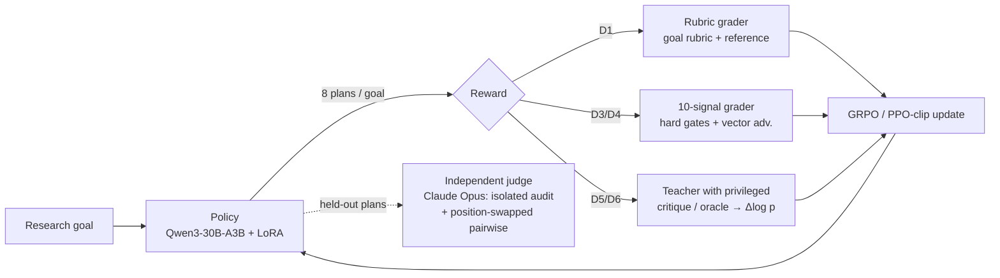

# co-scientist-rl

**RL post-training of a 30B LLM to write research plans.** This was a five-month research project (Dec 2025 – Apr 2026). I reproduced the rubric-reward GRPO recipe of Goel et al. ([arXiv:2512.23707](https://arxiv.org/abs/2512.23707)) at 30B scale. I then implemented and tested self-distillation, multi-signal rewards, test-time RL, evolving rubrics and literature-grounded rewards to try to go beyond it. Each result was evaluated with independent, bias-controlled LLM judges.

Author: Yuhong (Silas) Shi, Torr Vision Group, University of Oxford.

| | |
|---|---|
| Policy | Qwen3-30B-A3B (MoE), LoRA rank 64, trained through the [Tinker](https://thinkingmachines.ai/tinker/) API |
| Task / data | Research-plan generation on `facebook/research-plan-gen` (ML split; not redistributed) |
| **Reproduction** | Held-out rubric score **0.560 → 0.693** (640 goals × 8 samples, identical protocol before and after) |
| Scale of work | ~170 trainer / eval modules, 6 research directions, 80+ training runs, 120 unit tests |

## Skills demonstrated

| Area | What I implemented | Code | Write-up |
|---|---|---|---|
| Policy-gradient RL for LLMs | GRPO with group-relative advantages, PPO-clip, async sampling and grading at 512 grader calls per batch | [`best_ver.py`](src/co_scientist/rubric_reward/grpo/best_ver.py) | [01](docs/algorithms/01-grpo-rubric-reward.md) |
| Self-distillation | SDPO (self-teacher from grader feedback, mixed with GRPO); on-policy distillation from an external reviewer's critique; an off-policy relabelling variant | [`train_sdpo.py`](src/co_scientist/rubric_reward/sdpo/train_sdpo.py), [`train_opd.py`](src/co_scientist/d6_grant_proposal/train_opd.py), [`train_mu_v4.py`](src/co_scientist/d5_abstract_retrieve_refine/train_mu_v4.py) | [02](docs/algorithms/02-self-distillation.md) |
| Reward design | 10-signal goal-agnostic reward with hard gates and programmatic claim checks; per-signal vector advantages | [`ten_signal_reward.py`](src/co_scientist/shared/ten_signal_reward.py), [`train_7signal_vector.py`](src/co_scientist/ttt_discover/train_7signal_vector.py) | [03](docs/algorithms/03-multi-signal-vector-reward.md) |
| Test-time RL | Entropic objective with β set by a KL-budget binary search; UCB-selected, bottleneck-targeted critique–revise | [`train_buffer_ttt.py`](src/co_scientist/ttt_discover/train_buffer_ttt.py), [`train_critique_revise.py`](src/co_scientist/ttt_discover/train_critique_revise.py) | [04](docs/algorithms/04-critique-revise-rl.md) |
| Adaptive rubrics | Contrastive rubric generation, binary per-item grading, variance-based filtering, pluggable model client | [`rubric_buffer.py`](src/co_scientist/shared/rubric_buffer.py), [`rubric_evolution.py`](src/co_scientist/shared/rubric_evolution.py) | [05](docs/algorithms/05-evolving-rubrics.md) |
| LLM-as-judge evaluation | Balanced, anonymised, isolated audits; pairwise judging with hidden position swaps; asynchronous judge subagents over a file bus | [`audit_v3_isolated.py`](src/co_scientist/d5_abstract_retrieve_refine/audit_v3_isolated.py), [`opus_pairwise_subagent.py`](src/co_scientist/shared/opus_pairwise_subagent.py) | [06](docs/algorithms/06-llm-judge-evaluation.md) |
| Evaluation analysis | Best-of-N curves, oracle vs self-selection, rank correlation | [`eval_bon.py`](src/co_scientist/eval/eval_bon.py) | [07](docs/algorithms/07-selection-gap-bon.md) |
| Retrieval and grounding | OpenAlex forward search, Semantic Scholar backward references, token-span rewards for verified equations and citations | [`paper_retrieval.py`](src/co_scientist/shared/paper_retrieval.py), [`grounding.py`](src/co_scientist/d6_grant_proposal/grounding.py) | [08](docs/algorithms/08-retrieval-and-grounding.md) |

The literature behind these methods, and how each paper was used, is in **[READING.md](READING.md)**.

## System



## Key findings

1. **Reproduction works; going beyond it did not.** GRPO took the base model from 0.560 to 0.693 on held-out goals. The paper's strict binary reward gave a flat curve instead: in 28.5% of groups every sample got the same reward, so there was no gradient. A 4-level graded scale fixed that. No extension beat 0.693. Only two were evaluated formally (0.654 and 0.657); the rest were screened on training reward.
2. **The gap is selection, not capability, and the selector cannot fix it.**
   - Oracle best-of-8 reaches 0.849, against a mean of 0.681 and 0.867 for the reference plans. That puts 90.8% of the gap between the mean and the oracle.
   - The model's own rubric-blind self-selection is near chance (ρ = 0.063), because goal rubrics check the *reference's specific method*: in 80.6% of low-scoring items the reference scored high.
   - The maximum of noisy scores is biased upward, so this is an upper bound.
3. **Critique matters more than RL.** In per-goal test-time RL, conditioning revisions on per-signal critique added +0.19, while RL added +0.087, and only when it trained the exploration policy.
   - On grant proposals, RL pushed the proxy reward to 0.970 while an independent judge rated the plan 11 / 20. Critique–revise without RL got 16 / 20.
   - Cause: template collapse, not a wrong reward. Across conditions the proxy still ranked plans like the judge (ρ = +0.91).
4. **Grader validation has to come before training.**
   - The multi-signal reward ranked plans *against* the independent judge within a saturated score band (ρ = −0.16). Hardening the signals fixed it.
   - Self-distillation turned out to reward conformity to the critique rather than fidelity to the source.
   - Adding a verifier-grounded reward led to Goodharting on one axis.

   Each of these was caught by the evaluation protocol, and one 7–1 headline was retracted after re-judging (4–4).

Status: **concluded.** Full write-up in [`shared/analysis/reports/project_conclusion.md`](shared/analysis/reports/project_conclusion.md); every experiment is listed in [`shared/knowledge/EXPERIMENT_CATALOG.md`](shared/knowledge/EXPERIMENT_CATALOG.md).

## Repository map

```
src/co_scientist/          featured implementations (importable package)
  rubric_reward/           D1  GRPO + rubric reward, SDPO, selector
  ttt_discover/            D3  test-time RL, multi-signal vector GRPO, critique–revise
  grant_proposal/          D4  critique–revise + RL for grant proposals, evolving rubrics
  d5_abstract_retrieve_refine/  D5  self-distillation with privileged oracle, judge audits
  d6_grant_proposal/       D6  on-policy distillation, GRPO control, grounding reward
  ibt/                     D2  iterative brainstorming
  shared/                  rewards, graders, judge clients, retrieval
  eval/                    best-of-N / selection-gap evaluation
experiments/               94 superseded versions, ablations and probes (provenance)
docs/algorithms/           one page per method
projects/<direction>/      configs, run summaries, decision logs, findings
shared/                    tools, environment, cross-direction knowledge and reports
tests/                     unit tests
```

Directions are summarised in [`DIRECTIONS.md`](DIRECTIONS.md). The state before this reorganisation is tagged [`v0-snapshot`](https://github.com/Silasshi/co-scientist-rl/tree/v0-snapshot).

## Running
Key dependencies: Python 3.13, `tinker==0.7.0`, [tinker-cookbook](https://github.com/thinking-machines-lab/tinker-cookbook), `chz==0.4.0`, `torch==2.9.1`, `transformers==4.56.2`, `datasets==4.4.2`. The full environment, exported from conda, is in `shared/env/pip_freeze_tinker.txt`.

```bash
PYTHONPATH=src pytest tests/                                        # unit tests, no network needed
PYTHONPATH=src python -m co_scientist.rubric_reward.grpo.best_ver   # needs a Tinker account
```
Trainers use [chz](https://github.com/thinking-machines-lab/chz) configs (`key=value` overrides).

## Not included

Datasets, model checkpoints, raw rollouts and generated plans, paper drafts, third-party paper PDFs and API credentials are not included. `tinker://` checkpoint URIs in configs need a Tinker account.

## Attribution

The training loop is adapted from [tinker-cookbook](https://github.com/thinking-machines-lab/tinker-cookbook) (Apache-2.0); see [`NOTICE`](NOTICE) and `THIRD_PARTY_NOTICES/`. The task and rubric-reward method follow Goel et al. (2025).
