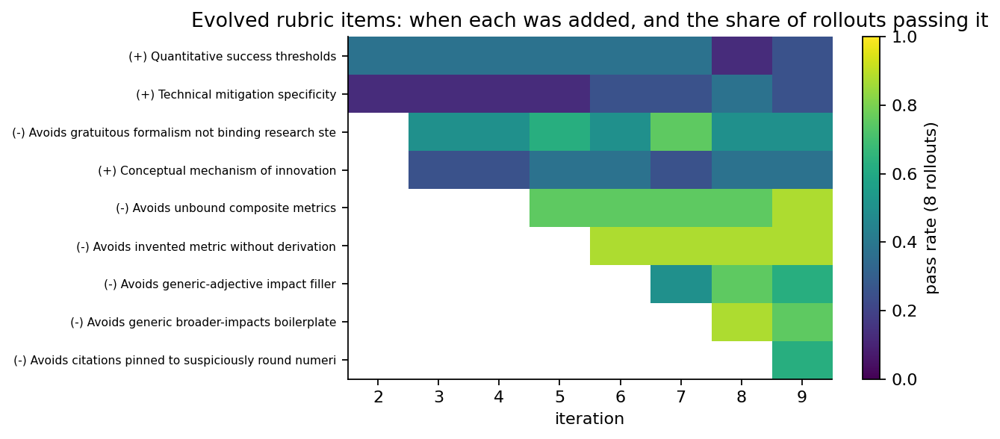
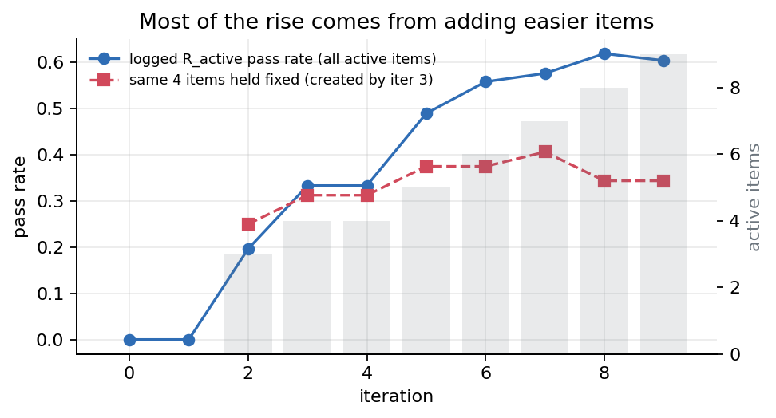

# Evolving rubrics during RL (DR Tulu style)

**Follows** Shao et al., *DR Tulu: Reinforcement Learning with Evolving Rubrics for Deep Research* ([arXiv:2511.19399](https://arxiv.org/abs/2511.19399)). The generator prompt also borrows OnlineRubrics' pairwise-contrast elicitation ([arXiv:2510.07284](https://arxiv.org/abs/2510.07284)). Here the task is grant-proposal writing.

> **Status: mechanism implemented and tested in short runs (3–10 iterations). There is no long training run and no held-out evaluation.** This folder shows the method and what the short runs reveal; it does not claim a training improvement.

## Method
A fixed rubric saturates: once every rollout passes an item, the item carries no gradient, and a policy can game what the rubric does not check. So during training, new rubric items are written that separate the **current** rollouts, and only the items that still discriminate are kept. Each iteration:

1. **Contrast.** Pick a strong and a weak rollout, or a rollout and the reference ([`rubric_evolution.py` L173](rubric_evolution.py#L173)).
2. **Generate.** A rubric model (Claude, via a pluggable `GenClient`) writes positive items (*what makes the better plan better*) and negative items (*failure modes to avoid*) grounded in the observed difference. The prompt is in [`rubric_gen_prompt.py`](rubric_gen_prompt.py); the step itself is [`rubric_evolution.py` L83](rubric_evolution.py#L83).
3. **Grade.** Each rollout is checked against each item with a short yes/no call ([`rubric_grader.py` L41](rubric_grader.py#L41)).
4. **Filter.** Items whose grades have zero variance are dropped, and the buffer is capped at the top K items by standard deviation, as in DR Tulu ([`rubric_buffer.py` L143](rubric_buffer.py#L143)).
5. **Couple into RL.** The evolving rubric (R_active) acts as an extra signal in the per-signal REINFORCE of the critique–revise loop. A revision's advantage is how much it raised the R_active pass rate over its parent ([`train_ger_cr.py` L1612](train_ger_cr.py#L1612)). This is controlled by `rubric_rl_coupling_enabled`.

Unlike DR Tulu, items are not grounded in web search, and the rubric enters as one signal next to a fixed 12-signal reward rather than as the whole reward.

## Run
```bash
python -m evolving_rubric.train_ger_cr config.goal_dir=evolving_rubric/data/goals/<your_goal> \
    config.rubric_evolution_enabled=true config.rubric_rl_coupling_enabled=true
```
You supply the goal text: see [Data](#data). Rubric generation runs through a file bus that an LLM worker answers (request and response JSON under `log_path`).

## What the runs show
These numbers come from the 10-iteration RL-coupled run `smoke_rl_coupled` (8 rollouts graded per item per iteration), recomputed from [`data/`](data/) by [`analysis/check_numbers.py`](analysis/check_numbers.py).




## Takeaways
**Verdict: no improvement shown.**
- The short runs exercise the mechanism, but nothing was trained long enough to compare against the GRPO reproduction.
- The one number that rises, the rubric pass rate, turns out to be a composition effect (point 3).
- What the runs do show is *how* the fixed reward gets hacked.

The details:

1. **The generator targets real Goodhart modes.**
   - 6 of the 9 evolved items are *negative* items naming specific gaming behaviours seen in the rollouts, such as:
     - "Avoids gratuitous formalism not binding research steps"
     - "Avoids invented metric without derivation"
     - "Avoids citations pinned to suspiciously round numeric anchors"
   - None of these are covered by the fixed 12-signal reward.
   - The offline pilot found the same pattern: 9 items from 3 contrast pairs, 4 of them aimed at fabricated numbers or template collapse ([`data/pilot/RESULTS_SUMMARY.md`](data/pilot/RESULTS_SUMMARY.md)).
2. **Every kept item discriminates.** The per-item standard deviation at its last iteration is ≥ 0.33, so no item had saturated. The reference proposal passes 87.5% of the active items, so the items are achievable.
3. **A rising rubric pass rate is not evidence of learning.**
   - The logged R_active pass rate rose from 0.20 to 0.60.
   - On the 4 items that existed from iteration 3, it moved only from 0.31 to 0.34, within noise at 8 rollouts.
   - Positive items stayed hard (0.29 at iteration 9). Negative items pass 0.71 on average.
   - Most of the rise comes from adding easier, mostly negative items. Any evaluation of evolving rubrics has to hold the item set fixed.
4. **Deduplication by exact title is too weak.** In `smoke_no_rl`, "Avoids Decorative Equations Not Bound to (the) Method" was added twice. Matching should be semantic.

## Data
| Path | Contents |
|---|---|
| [`data/runs.csv`](data/runs.csv) | the three runs and how they differ |
| `data/runs/<run>/rubric_buffer.jsonl` | **the evolved rubric items**: title, description, positive or negative, weight, creation iteration, and the per-iteration binary grades of every rollout on that item |
| `data/runs/<run>/rubric_anchor_log.jsonl` | drift diagnostic: the reference proposal graded against the active rubric |
| `data/runs/<run>/metrics.csv`, `iter_summary.csv`, `config.json` | per-iteration training metrics (`r_active/*` once the rubric is coupled into RL) and the exact config |
| [`data/pilot/RESULTS_SUMMARY.md`](data/pilot/RESULTS_SUMMARY.md) | offline pilot: 3 contrast pairs → 9 generated items, checked against pre-set success criteria |
| `data/goals/01_foundopt/weights.json` | signal weights for the goal used |

`smoke_no_rl` was resumed mid-run, so its `metrics.csv` repeats some `iter` values.

**Not included:**
- the goal text and distractor goals, whose provenance is not ours to republish
- the reference proposal
- plan buffers

To run the trainer, place your own `research_goal.md` in `data/goals/<name>/`. Optionally add `alt_goals.json` = `{"alt_goals": [{"goal": ..., "target": ...}]}`.

## Limitations
- Short runs on one goal, one run per setting.
- No independent judge and no comparison against training without evolving rubrics. Whether coupling improves plan quality is **untested**.
- The logged R_active rate weights negative items ×1.5; the per-item analyses above are unweighted.
