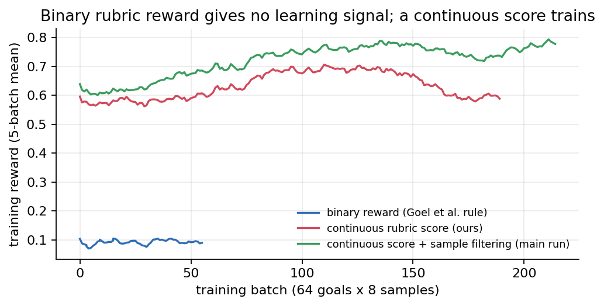
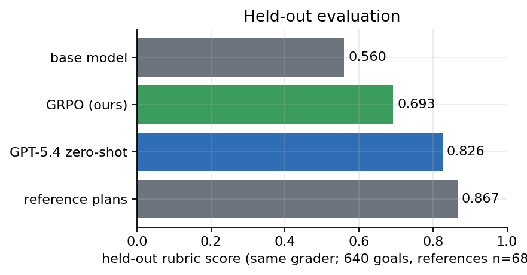
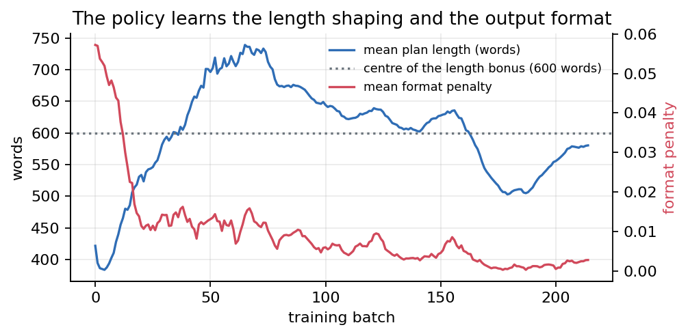
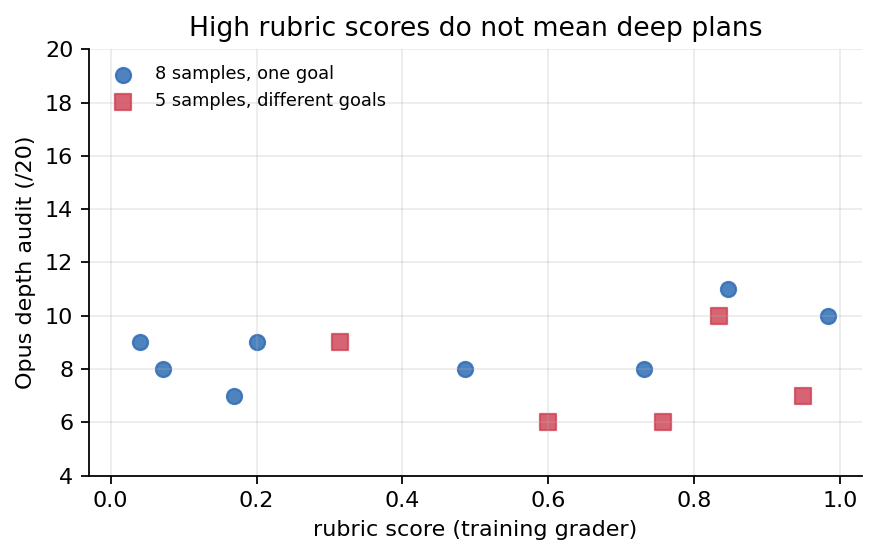

# GRPO with a continuous rubric reward

This folder is the reproduction that every other method in the repo is compared against.

It **reproduces** Goel et al., *Training AI Co-Scientists Using Rubric Rewards* ([arXiv:2512.23707](https://arxiv.org/abs/2512.23707)):
- same task and dataset (ResearchPlanGen, `facebook/research-plan-gen`)
- same model, Qwen3-30B-A3B
- same training loop: GRPO ([DeepSeekMath, arXiv:2402.03300](https://arxiv.org/abs/2402.03300)), with a frozen copy of the policy as the grader

The paper's code was not released, so everything here is implemented from the paper.

## Method
1. For each research goal, the policy (Qwen3-30B-A3B + LoRA rank 64) samples **8 plans**.
2. A frozen copy of the model grades each plan against the goal-specific rubric and the reference plan.
3. **Continuous rubric score.** Goel et al. count a rubric item as satisfied only if the plan has zero violations, which makes the reward binary.
   - Here the grader instead rates every item on 7 general desiderata at 4 levels, mapped to {0, 0.2, 0.6, 1.0}.
   - The plan's score is the mean of these ratings, a continuous value in [0, 1].
   - The reward is this score, plus a small length bonus, minus a format penalty.
4. The advantage is the reward minus the group mean (no value network). The update uses PPO-clip.

| Step | Code |
|---|---|
| Grader XML → continuous rubric score | [`train.py` L229 `compute_rubric_reward_from_xml`](train.py#L229) |
| Reward = rubric + 0.08 · length bonus − format penalty | [`train.py` L640](train.py#L640) |
| Group-relative advantage `r − mean(group)` | [`train.py` L697](train.py#L697) |
| PPO-clip loss (ε = 0.2, no KL) via Tinker | [`train.py` L804](train.py#L804) |
| Best-of-N + rubric-blind self-selection eval | [`eval_bon.py` L104, L203](eval_bon.py#L203) |

## Run
```bash
export TINKER_API_KEY=...                     # see ../README.md#installation
python -m grpo.train log_path=runs/grpo/main  # settings of the reported run: configs/grpo_main.json
python -m grpo.eval_bon checkpoint_run_path=runs/grpo/main
```
Fields missing from `configs/*.json` take the defaults of `Config` in [`train.py`](train.py).

## Results
- The eval set is 640 held-out goals × 8 samples.
- Every row is scored by the same frozen grader.
- Every number below is recomputed from [`data/`](data/) by [`analysis/check_numbers.py`](analysis/check_numbers.py).

| | Held-out rubric score |
|---|---|
| Base model | 0.560 |
| **GRPO, 215 batches (reproduction)** | **0.693** (+23.7% relative) |
| GPT-5.4 zero-shot (640 × 1) | 0.826 |
| Reference plans (n = 685) | 0.867 |

The paper reports 12–22% relative improvement, judged by a jury of frontier models. Here the gain is +23.7%, measured by the frozen self-grader, which is the paper's training signal. The two are measured by different evaluators, so they show a gain of similar size, not the same number.







## Takeaways
1. **The reproduction needs a continuous score.**
   - Under Goel et al.'s binary rule, training reward stayed flat: 0.103 → 0.095 over 60 batches.
   - 64.5% of samples scored exactly 0, and 28.7% of GRPO groups had zero reward variance, so those groups contribute no gradient.
   - The continuous score restores variance within groups, and GRPO then raises the held-out score from 0.560 to 0.693.
2. **The policy mainly learned format and patterns, not depth.**
   - *Format.*
     - The share of format-valid eval samples rose from 76.2% to 100%.
     - The mean format penalty fell from 0.048 to 0.002.
     - Plan length moved to the centre of the length bonus: 406 → 579 words, after overshooting to about 740.
     - The rubric gain itself is not a length effect: it appears in all 5 length bins.
   - *Patterns.*
     - The goal-specific rubric checks whether a plan takes the reference's framing and solution, not how deep the plan is.
     - A blind Claude Opus depth audit (math, novelty, realism, rigor; /20) of 13 plans from the trained checkpoint scored every plan 6–11 / 20.
     - Within one goal, rubric scores spanned 0.04–0.98 while Opus scores spanned 7–11. The correlation was r = 0.58 (n = 8, not significant).
     - Across goals the correlation was r = −0.17. The highest-rubric plan (0.949) scored 7 / 20: it invented a baseline and reported implausible throughput numbers.
   - The reward is easy to satisfy with the right framing and too coarse to reward deep scientific content.
3. **The remaining rubric gap is selection, not generation.**
   - Among its own 8 samples, the policy's best scores 0.849, against a mean of 0.681. That covers 90.8% of the gap from the mean to the reference plans.
   - The policy cannot find that best sample itself: its rubric-blind self-scores rank its samples at chance (Spearman 0.063), and self-selection reaches only 0.694.

## Data
Everything here is numeric; no plan, grader or critique text is included. Run names map to the original run ids in [`data/runs.csv`](data/runs.csv).

| Path | Contents | Granularity |
|---|---|---|
| `data/train_metrics/<run>.csv` | training reward per batch. `.batch_summary.csv` adds advantage, length and format stats (`format_rate` = mean format penalty) | 1 row per batch |
| `data/train_samples/<run>.parquet` | `batch_idx, group_idx, sample_idx, rubric_score, format_penalty, final_reward` | 1 row per valid training sample |
| `data/eval/<run>.<tag>.parquet` | held-out eval per sample: `rubric_score`, `word_count`, `is_compliant`. Best-of-N files add `self_eval_score`, `is_oracle_pick`, `is_self_pick` | 1 row per valid eval sample |
| `data/eval/<run>.<tag>_summary.csv` | per eval batch: `samples/generated`, `samples/valid`, `rubric/sample_mean_all` | 1 row per eval batch |
| [`data/rubric_audit.csv`](data/rubric_audit.csv) | blind Opus depth audit: 4 sub-scores and total (/20) next to the rubric score | 1 row per audited plan |

**Two eval averages.**
- Headline scores average over **all generated samples**, including format-invalid ones (`rubric/sample_mean_all`, weighted by `samples/generated`).
- The per-sample parquet files keep valid samples only, so their plain mean is the valid-only score (base 0.567 on 3,900 of 5,120).

**Protocol.**
- Generation runs at temperature 1.0.
- The grader is frozen Qwen3-30B-A3B at temperature 0. It sees the goal-specific rubric and the reference plan.

## Limitations
- One training run and one grader family.
- The grader that produced the training reward also scores the eval.
- Reference plans are graded with themselves in the grader's context, which can inflate their score.
- The maximum of 8 noisy scores is biased upward, so best-of-8 is an upper bound.
- The Opus audit covers 13 plans with one judgment each. It shows what the rubric misses; it does not measure that miss precisely.
