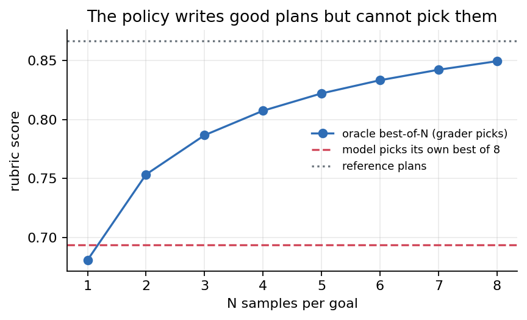

# GRPO with an LLM-judge rubric reward

**Reproduces** Goel et al., *Training AI Co-Scientists Using Rubric Rewards* ([arXiv:2512.23707](https://arxiv.org/abs/2512.23707)) at 30B scale, using GRPO ([DeepSeekMath, arXiv:2402.03300](https://arxiv.org/abs/2402.03300)).

## Method
1. For each research goal, the policy (Qwen3-30B-A3B + LoRA rank 64) samples **8 plans**.
2. A frozen copy of the model grades each plan. It sees the goal, the goal-specific rubric items and a reference plan, and rates every item on 7 general desiderata, at 4 levels each, mapped to {0, 0.2, 0.6, 1.0}.
3. The plan's reward is the mean rating, plus a small length bonus, minus a format penalty.
4. The advantage is the reward minus the group mean (no value network). The update uses PPO-clip.

| Step | Code |
|---|---|
| Grader XML → rubric score | [`train.py` L228 `compute_rubric_reward_from_xml`](train.py#L228) |
| Reward = rubric + 0.08 · length bonus − format penalty | [`train.py` L638](train.py#L638) |
| Group-relative advantage `r − mean(group)` | [`train.py` L696](train.py#L696) |
| PPO-clip loss (ε = 0.2, no KL) via Tinker | [`train.py` L803](train.py#L803) |
| Best-of-N + rubric-blind self-selection eval | [`eval_bon.py` L103, L202](eval_bon.py#L202) |

## Run
```bash
export TINKER_API_KEY=...                     # see ../README.md#setup
python -m grpo.train log_path=runs/grpo/main  # settings of the reported run: configs/grpo_main.json
python -m grpo.eval_bon checkpoint_run_path=runs/grpo/main
```

## Results
Evaluation uses 640 held-out goals × 8 samples and the same frozen grader for every row. Every number below is recomputed from [`data/`](data/) by [`analysis/check_numbers.py`](analysis/check_numbers.py).

| | Held-out rubric score |
|---|---|
| Base model | 0.560 |
| **GRPO, 215 batches** | **0.693** |
| GPT-5.4 zero-shot (640 × 1) | 0.826 |
| Reference plans (n = 685) | 0.867 |




## Takeaways
1. **A binary rubric reward gives GRPO almost no signal.**
   - Under Goel et al.'s rule (an item is satisfied only if it has zero violations), training reward stayed flat: 0.103 → 0.095 over 60 batches.
   - 64.5% of samples scored exactly 0, and 28.7% of GRPO groups had zero reward variance, so they contribute no gradient.
   - A 4-level graded scale restores the variance within groups, and training works.
2. **GRPO raised the held-out score by +0.133** (0.560 → 0.693), but the score stays far below a frontier model at zero-shot (0.826).
3. **The remaining gap is mostly selection, not capability.**
   - Among its own 8 samples, the trained policy's best scores 0.849, against a mean of 0.681. That covers 90.8% of the gap from the mean to the reference plans.
   - The policy cannot find that best sample itself: its own rubric-blind scores rank its samples at chance (Spearman 0.063), and self-selection reaches only 0.694.
   - Goal-specific rubrics check the reference's *particular* method, which the model cannot infer.

## Limitations
- One training run, one grader family.
- The grader that produced the training reward also scores the eval. Reference plans are graded with themselves in the grader's context, which can inflate their score.
- The maximum of 8 noisy scores is biased upward, so best-of-8 is an upper bound.
- Headline means count format-invalid samples. The base model has 76.2% valid samples; [`data/README.md`](data/README.md) explains both averages.
