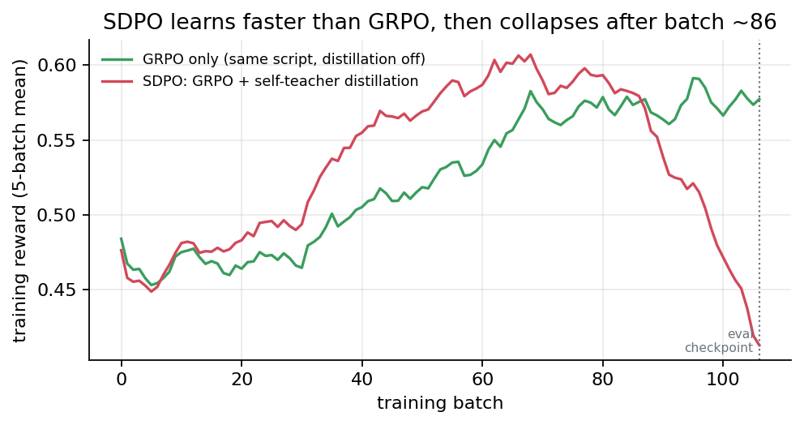
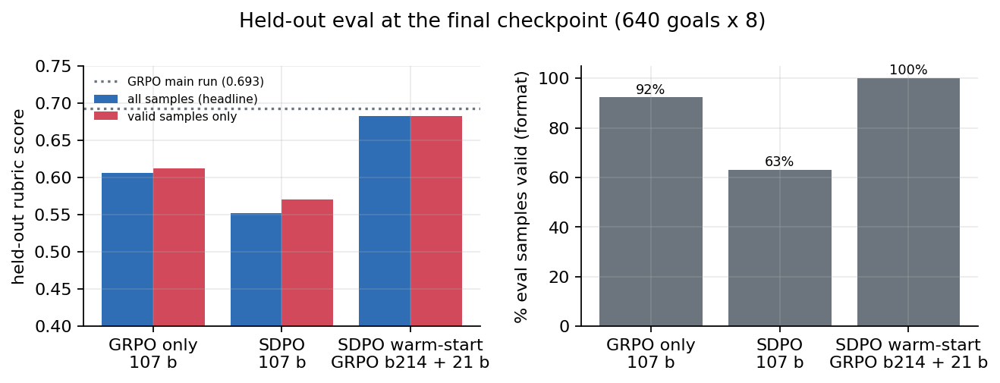

# Self-distillation from grader feedback (SDPO)

**Follows** Hübotter et al., *Reinforcement Learning via Self-Distillation* (SDPO, [arXiv:2601.20802](https://arxiv.org/abs/2601.20802)).

## Method
A scalar reward says *how good* a plan was, not *which tokens* were wrong. SDPO uses the model itself as the teacher:
- The **student** writes a plan from the normal prompt.
- The grader's critique of that plan (its weaknesses and suggested fixes) is added to the prompt. The same model, now seeing this privileged feedback, scores the student's tokens: this is the **teacher**.
- The per-token advantage `log p_teacher − log p_student` pushes up tokens that the model would write more confidently if it knew the fix.

Here this distillation signal is mixed with the GRPO advantage from [`grpo/`](../grpo/).

| Step | Code |
|---|---|
| Parse grader XML into per-plan weaknesses / fixes | [`train.py` L1489](train.py#L1489) |
| Build the self-teacher prompt (original prompt + feedback) | [`train.py` L1689](train.py#L1689) |
| Teacher regularised toward the initial policy (SDPO appendix) | [`train.py` L2364](train.py#L2364) |
| Per-token advantage `teacher_lp − student_lp`, solution tokens only, clipped to ±5 | [`train.py` L3496](train.py#L3496) |
| Mix `λ·A_GRPO + (1−λ)·A_SDPO` (code default λ = 0.30) | [`train.py` L3531](train.py#L3531) |
| Same script with `use_sdpo=False` → GRPO-only control | [`train.py` L211](train.py#L211) |

## Run
```bash
python -m sdpo.train log_path=runs/sdpo/main                  # SDPO
python -m sdpo.train log_path=runs/sdpo/control use_sdpo=false # GRPO-only control, same code path
```

## Results
SDPO and its control use the same script, 107 batches each, and the same eval set as GRPO (640 goals × 8). Every number is recomputed from [`data/`](data/) by [`analysis/check_numbers.py`](analysis/check_numbers.py).

| | Train reward, peak (5-batch mean) | Eval, all samples | Eval, valid only | Valid share |
|---|---|---|---|---|
| GRPO-only control | 0.591 (batch 95) | **0.607** | 0.612 | 92.3% |
| SDPO | **0.607 (batch 68)** | 0.552 | 0.570 | 63.2% |
| SDPO warm-started from GRPO b214 (+21 batches) | — | 0.682 | 0.682 | 100% |

For reference, the GRPO main run scores 0.693 ([`grpo/`](../grpo/)).




## Takeaways
**Verdict against the GRPO reproduction: no clear improvement.**
- The final SDPO checkpoint scores 0.552, below both the same-script control (0.607) and the reproduction (0.693).
- Warm-starting SDPO from the reproduction does not beat it either.

The details:

1. **Self-distillation helps early, then collapses.**
   - SDPO's training reward is above the GRPO-only control for 80 of 107 batches.
   - It peaks at 0.607 (batch 68), higher than the control ever gets (0.591).
   - After batch 86 it falls fast: over batches 90–106 it averages 0.469, against 0.576 for the control.
2. **The final-checkpoint eval lands inside the collapse.** SDPO scores 0.552, against 0.607 for the control. It is also worse when only valid samples are counted (0.570 vs 0.612).
3. **Warm-starting SDPO from the best GRPO checkpoint did not push past it.** It scored 0.682 after 21 more batches, against 0.693 for the starting checkpoint.
4. **What the data rules out:** format failures do not explain the collapse.
   - During training, the control actually had *more* format-noncompliant drops in its last 10 batches (59.8 per batch vs 26.4).
   - SDPO's eval valid share is still much lower (63% vs 92%), and the logged data does not record why those eval samples failed.

**Hypotheses, not tested here:**
- The teacher is the current policy, so its targets drift with it.
- The spread of the SDPO advantage shrinks over training (std 0.73 → 0.40), so the GRPO term may dominate late. This is consistent with the curve but not established.

**Practical implication:** with self-distillation, select checkpoints on a validation set rather than taking the last one. No checkpoint near batch 68 was evaluated, so whether it would have beaten the control is unknown.

## Data
- Same format and protocol as [`grpo/`](../grpo/README.md#data), with one CSV, parquet and summary set per run.
- Run names map to the original run ids in [`data/runs.csv`](data/runs.csv).
- `configs/*.json` hold the run-level fields the trainer saved: model, lr, batch, group size and LoRA rank.
- The SDPO-specific settings were not saved. The control was run with `use_sdpo=false`.

## Limitations
- One seed per arm.
- The mixing weight λ is not recorded in the saved run config (code default 0.30).
- SDPO's 20 earlier exploratory runs (different λ / feedback formats) are not included here. They are on the [`archive` branch](https://github.com/Silasshi/co-scientist-rl/tree/archive/projects/rubric_reward/runs/2026_02/SDPO).
