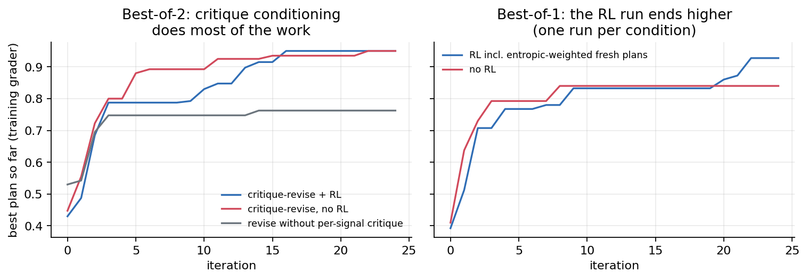
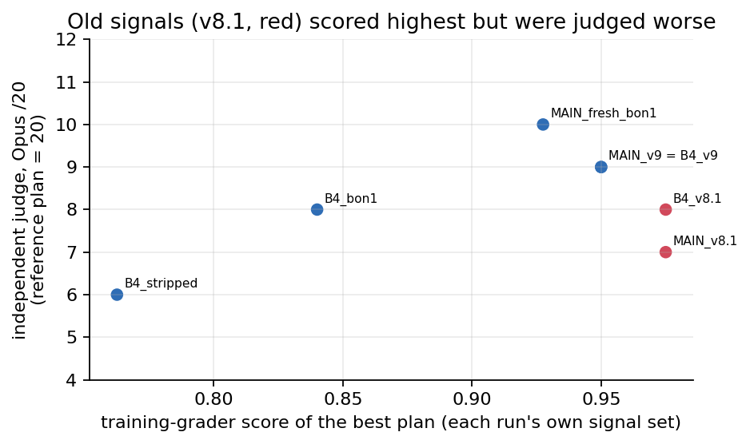

# Test-time training that reuses past attempts (TTT-Discover style)

**Follows** Yuksekgonul et al., *Learning to Discover at Test Time* (TTT-Discover, [arXiv:2601.16175](https://arxiv.org/abs/2601.16175)). Instead of training one policy for all goals, keep training **on the single goal you care about**. Each new attempt is built from the best past attempts, and the best plan found is kept.

## Method
Each iteration of [`train.py`](train.py) (the CR-v7 loop) has four phases:
1. **Reuse a buffer of past attempts.** Parents are chosen from the buffer with UCB: `reward + c·sqrt(ln N / (1 + n_selected))` ([`train_critique_revise.py` L297](train_critique_revise.py#L297), called at [`train.py` L501](train.py#L501)).
2. **Critique–revise.** For each parent, find its weakest signal ([`train_critique_revise.py` L324](train_critique_revise.py#L324)) and generate a revision aimed at it. New fresh plans are also sampled.
3. **Score** every plan with a 10-signal, goal-agnostic reward:
   - weights at [`rewards/ten_signal_reward.py` L856](rewards/ten_signal_reward.py#L856)
   - hard gates for goal contrast and programmatic claim checks at [`../common/seven_signal_reward.py` L98](../common/seven_signal_reward.py#L98)
4. **Update.**
   - Revisions get a per-signal REINFORCE advantage (improvement on the targeted signal) ([`train.py` L743](train.py#L743)).
   - With `config.train_on_fresh=true`, fresh plans get **entropic weights** `softmax(β·R)`, which favour the best samples rather than the mean ([`train.py` L711](train.py#L711)). β is set adaptively by binary search to hit a KL budget ([`train_entropic.py` L528–L553](train_entropic.py#L528)).

Ablations switch parts off: `config.skip_rl_update=true` gives in-context critique–revise only ("B4"); `config.strip_critiques=true` removes the per-signal critique from the revision prompt.

## Run
```bash
python -m ttt.train config.log_path=runs/ttt/main config.train_on_fresh=true   # goal: data/research_goal.txt
python -m ttt.train config.log_path=runs/ttt/no_rl config.skip_rl_update=true
```
The exact configs of every run are in `data/runs/<name>/config.json`.

## Results
All runs are on one goal, with 25 iterations and one run per condition. The score is that of the best plan found, under the training grader (Qwen3-30B-A3B, 10 signals). The independent judge (Claude Opus) scored each run's best plan once, out of 20; the reference plan gets 20. Numbers are recomputed from [`data/`](data/) by [`analysis/check_numbers.py`](analysis/check_numbers.py).

| Condition | Training grader | Opus /20 |
|---|---|---|
| Revise **without** per-signal critique, no RL | 0.763 | 6 |
| Critique–revise, no RL (best-of-2) | 0.950 | 9 |
| Critique–revise + RL (best-of-2) | 0.950 | 9 |
| Critique–revise, no RL (best-of-1) | 0.840 | 8 |
| **Critique–revise + RL incl. entropic-weighted fresh plans (best-of-1)** | **0.928** | **10** |
| Old signal set v8.1, RL / no RL | 0.975 / 0.975 | 7 / 8 |




## Takeaways
**Verdict: no clear improvement from test-time RL.**
- At best-of-2, test-time RL ends at exactly the score of the same loop without RL.
- At best-of-1 the RL run ends higher, but this is a single run and the typical sample does not improve.
- The training grader also over-rates every condition: it gives up to 0.95–0.975 while the independent judge gives 6–10 / 20, against 20 for the reference.

The details:

1. **Conditioning revisions on a per-signal critique is the main lever, inside the grader's view.**
   - It adds +0.19 with no training at all (0.763 → 0.950).
   - The independent judge sees a much smaller change (6 → 9 / 20).
2. **RL on top adds little at best-of-2.** RL and no-RL end at the same score, and RL is ahead only during iterations 16–21.
3. **At best-of-1, the run with RL on fresh plans ends higher, but only its best plan improves.**
   - Final score 0.928 vs 0.840 (Opus 10 vs 8).
   - The *mean* fresh-plan reward barely differs (0.433 vs 0.425).
   - With one run per arm, the gain cannot be attributed with confidence.
4. **The grader is hacked before the policy is.**
   - The earlier v8.1 signal set let both runs reach 0.975, while the independent judge rated those plans 7–8 / 20.
   - Adding formalism and arithmetic-consistency signals (v9) lowered the reachable score to 0.950 and raised the judge's score to 9 / 20.
   - Validate the grader on reference plans before training on it.

## Data
- Per-goal runs on one research goal: [`data/research_goal.txt`](data/research_goal.txt), our own description of the TTT-Discover problem.
- 25 iterations each.
- Run names map to the original run dirs in [`data/runs.csv`](data/runs.csv).

| File | Contents |
|---|---|
| `data/runs/<run>/metrics.csv` | per iteration: `reward/buffer_max` (best plan so far, training grader), fresh and revision reward means, per-signal means, β of the entropic weights |
| `data/runs/<run>/iter_summary.csv` | per-iteration training summary |
| `data/runs/<run>/config.json` | exact config of the run |
| [`data/opus_judge_scores.csv`](data/opus_judge_scores.csv) | independent judge (Claude Opus) score of each run's best plan: /20 total with 4 sub-scores out of 5, and where each score was recorded |

The training-grader score is the 10-signal reward from [`rewards/ten_signal_reward.py`](rewards/ten_signal_reward.py), graded by Qwen3-30B-A3B. Plan buffers (plan text) and the reference plan are not included.

## Limitations
- One goal, one run per condition.
- The Opus scores are single judgments of a single plan, recorded by hand (see `source` in [`data/opus_judge_scores.csv`](data/opus_judge_scores.csv)). Read 1–2 point differences as noise.
- The training-grader scores of v8.1 and v9 come from different signal sets, so they are not on the same scale.
